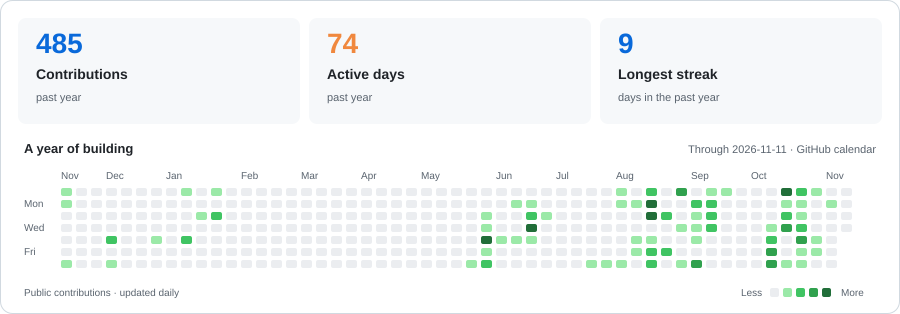

<picture>
  <source media="(prefers-color-scheme: dark)" srcset="assets/banner-dark.svg" />
  <source media="(prefers-color-scheme: light)" srcset="assets/banner-light.svg" />
  
</picture>

  
  
  
  

I'm an Information Technology student at the University of Transport (UTH) who builds full products rather than single screens: a native Android client, the Spring Boot services behind it, and applied AI where it earns its place. I care about the unglamorous parts that make software trustworthy, such as data integrity, offline behaviour, automated tests and honest documentation.

<table>
  <tr>
    <td align="center" valign="top" width="25%"><h3>7</h3>backend services on a team platform</td>
    <td align="center" valign="top" width="25%"><h3>212</h3>commits to that platform</td>
    <td align="center" valign="top" width="25%"><h3>600+</h3>automated tests in three projects</td>
    <td align="center" valign="top" width="25%"><h3>1</h3>paper co-authored, AI King 2025</td>
  </tr>
</table>

## Featured work

<table>
  <tr>
    <td width="50%" valign="top">
      <h3><a href="https://github.com/quanhocdev/cruise-management-system">Cruise Tour Management</a></h3>
      <b>Team project</b> · Android and backend
      
A microservice platform that runs a cruise from tour planning to booking, QR and NFC check-in, onboard billing and final checkout.

      <ul>
        <li>Built passenger and staff flows in the Android app, from booking to the assignment inbox</li>
        <li>Enforced ownership on booking and payment reads, and integrated UUID user identities across services</li>
      </ul>
      <code>Kotlin</code> <code>Compose</code> <code>Spring Boot</code> <code>Kafka</code> <code>Redis</code> <code>PostgreSQL</code>
    </td>
    <td width="50%" valign="top">
      <h3><a href="https://github.com/TrinhQuocDat542005/The-Golden-Leaf">The Golden Leaf</a></h3>
      <b>Personal project</b> · Android, API and staff dashboard
      
Restaurant booking and operations, with the server as the source of truth for table holds, pricing and permissions.

      <ul>
        <li>Prevents double booking with atomic operations and database locks, covered by concurrency tests on real MySQL</li>
        <li>191 backend tests, browser E2E against the real API, and a <a href="https://github.com/TrinhQuocDat542005/The-Golden-Leaf/releases/tag/portfolio-v0.10.0">checksummed demo release</a></li>
      </ul>
      <code>Kotlin</code> <code>Compose</code> <code>Spring Boot</code> <code>MySQL</code> <code>Flyway</code> <code>Playwright</code>
    </td>
  </tr>
  <tr>
    <td width="50%" valign="top">
      <h3><a href="https://github.com/TrinhQuocDat542005/LingoLens">LingoLens</a></h3>
      <b>Personal project</b> · Android, API and admin console
      
Learn English by pointing your camera at everyday objects. Images are processed on the phone and never uploaded.

      <ul>
        <li>Offline-first: a durable Room outbox with stable operation IDs syncs learning data when the network returns</li>
        <li>162 Android and 118 backend tests on the <a href="https://github.com/TrinhQuocDat542005/LingoLens/tree/feature/analytics-mobile">latest feature branch</a></li>
      </ul>
      <code>Kotlin</code> <code>CameraX</code> <code>ML Kit</code> <code>Room</code> <code>Spring Boot</code> <code>React</code>
    </td>
    <td width="50%" valign="top">
      <h3><a href="https://github.com/TrinhQuocDat542005/chatbot-tuyensinh">UTH Admissions Assistant</a></h3>
      <b>Research-based project</b> · Vietnamese NLP
      
A Vietnamese admissions chatbot with contextual follow-ups, sourced data and a local web demo, following a co-authored <a href="https://github.com/TrinhQuocDat542005/chatbot-tuyensinh/tree/main/docs/research">AI King 2025 paper</a>.

      <ul>
        <li>Released model scores 0.90 intent macro-F1 and 0.96 entity F1 on a fixed 154-sentence test set</li>
        <li>141 Python tests, and a CI workflow that retrains the model and gates it on regression thresholds</li>
      </ul>
      <code>Python</code> <code>Rasa</code> <code>Docker</code> <code>GitHub Actions</code>
    </td>
  </tr>
</table>

**Also built:** [Industrial Defect VQA](https://github.com/TrinhQuocDat542005/Industrial_Defect_VQA), defect detection with YOLOv8, segmentation with U-Net and visual question answering · [AI Video Factory](https://github.com/TrinhQuocDat542005/Chipchip), a Chinese-to-Vietnamese dubbing pipeline with ASR, LLM translation, TTS and automated quality checks

These are portfolio and team projects, not commercial deployments. Each repository documents its demo steps, test evidence and current limits.

## How I work

<table>
  <tr>
    <td width="24%" valign="top"><b>Correctness first</b></td>
    <td>Business rules live on the server, and the risky ones get concurrency, ownership and idempotency tests.</td>
  </tr>
  <tr>
    <td width="24%" valign="top"><b>Built for bad networks</b></td>
    <td>Local storage and sync queues keep Android apps usable offline, with the server confirming what counts.</td>
  </tr>
  <tr>
    <td width="24%" valign="top"><b>Evidence over claims</b></td>
    <td>CI gates, reproducible evaluations and written trade-offs let a reviewer check the work, including what is unfinished.</td>
  </tr>
</table>

To see how I think: [LingoLens architecture](https://github.com/TrinhQuocDat542005/LingoLens/blob/main/docs/architecture.md) · [The Golden Leaf case study](https://github.com/TrinhQuocDat542005/The-Golden-Leaf/blob/main/docs/week-7-portfolio.md) · [Admissions Assistant evaluation](https://github.com/TrinhQuocDat542005/chatbot-tuyensinh#đánh-giá)

## Tech stack

<table>
  <tr>
    <td width="24%" valign="top"><b>Languages</b></td>
    <td>   </td>
  </tr>
  <tr>
    <td width="24%" valign="top"><b>Android</b></td>
    <td>   </td>
  </tr>
  <tr>
    <td width="24%" valign="top"><b>Backend</b></td>
    <td>    </td>
  </tr>
  <tr>
    <td width="24%" valign="top"><b>Applied AI</b></td>
    <td>   </td>
  </tr>
  <tr>
    <td width="24%" valign="top"><b>Delivery</b></td>
    <td>   </td>
  </tr>
</table>

## GitHub activity

<picture>
  <source media="(prefers-color-scheme: dark)" srcset="assets/activity-dark.svg" />
  <source media="(prefers-color-scheme: light)" srcset="assets/activity-light.svg" />
  
</picture>

Updated daily from the public GitHub contribution calendar.
