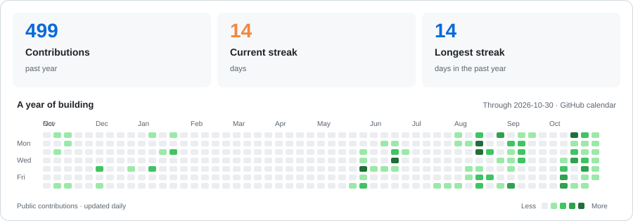

# 👋 Hi there, I'm Trịnh Quốc Đạt

**Android · Backend · Applied AI**

I build Android apps, backend services and AI experiments, with a focus on practical projects, clear documentation and reproducible demos.

[Explore my repositories →](https://github.com/TrinhQuocDat542005?tab=repositories)

---

### Tech Stack

  
  
  
  
  
  
   
  
  
  
  
  
  

### Featured Projects

<table>
  <tr>
    <td width="33%" valign="top">
      <h3>📷 LingoLens</h3>
      
English learning on Android with camera-based object recognition, a personal word library and offline review.

      
<code>Kotlin</code> <code>Spring Boot</code> <code>PostgreSQL</code>

      <a href="https://github.com/TrinhQuocDat542005/LingoLens">Explore project ↗</a>
    </td>
    <td width="33%" valign="top">
      <h3>🍃 The Golden Leaf</h3>
      
Restaurant booking and operations: an Android app, a shared REST API and a staff dashboard.

      
<code>Kotlin</code> <code>Java</code> <code>MySQL</code>

      <a href="https://github.com/TrinhQuocDat542005/The-Golden-Leaf">Explore project ↗</a>
    </td>
    <td width="33%" valign="top">
      <h3>💬 Admissions Assistant</h3>
      
A Vietnamese admissions chatbot with contextual follow-up questions, source links and a local web demo.

      
<code>Python</code> <code>Rasa</code> <code>Docker</code>

      <a href="https://github.com/TrinhQuocDat542005/chatbot-tuyensinh">Explore project ↗</a>
    </td>
  </tr>
</table>

Portfolio and learning projects. Demos, validation results and current limits are documented in each repository.

### Project Notes

| Read | Topic |
| :--- | :--- |
| [LingoLens — architecture & decisions](https://github.com/TrinhQuocDat542005/LingoLens/blob/main/docs/architecture.md) | On-device vision, offline data and API boundaries |
| [The Golden Leaf — portfolio case study](https://github.com/TrinhQuocDat542005/The-Golden-Leaf/blob/main/docs/week-7-portfolio.md) | Booking flows, Android and backend integration |
| [Admissions Assistant — evaluation & demos](https://github.com/TrinhQuocDat542005/chatbot-tuyensinh#đánh-giá) | Vietnamese NLU and reproducible local demos |

### More to Explore

- [Industrial Defect VQA](https://github.com/TrinhQuocDat542005/Industrial_Defect_VQA) — detection, segmentation and visual question answering for industrial defect inspection.
- [AI Video Factory](https://github.com/TrinhQuocDat542005/Chipchip) — an experimental pipeline for video translation, dubbing and subtitle timing.

### GitHub Activity

<picture>
  <source media="(prefers-color-scheme: dark)" srcset="assets/activity-dark.svg" />
  <source media="(prefers-color-scheme: light)" srcset="assets/activity-light.svg" />
  
</picture>

Updated daily from the public GitHub contribution calendar. Current streak includes yesterday if today has no contributions. Calendar dates follow GitHub.

---

Thanks for stopping by. Explore a project, read the notes, and follow along as I build.

